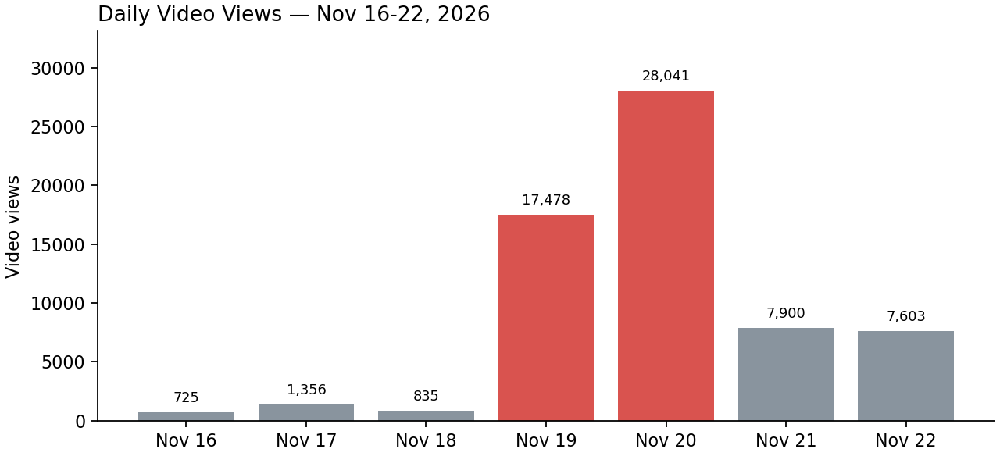

# TikTok Creator Analytics: What Drives Views on a Short-Form Video Account?

Performance analysis of a short-form video account I operate and manage (198 posts), using TikTok Studio analytics. As of November 24, 2026, the account had **198 posts, 370 followers, and 52.5K likes** on its public profile (TikTok Studio shows 53K likes). Two findings run the whole operation: almost all discovery comes through Search, and serialized storyline content dominates everything else.

> Titles and creator details are anonymized in the public datasets; metrics are as reported by TikTok Studio.

## Business questions

1. Where do views actually come from — the For You feed, or somewhere else?
2. What explains a sudden spike in daily views?
3. Which kinds of content should I prioritize when planning what to post?

## Data & verification

Data was read directly from TikTok Studio on **November 24, 2026**, and the daily Overview export in this repo covers **November 16–22, 2026** — the Studio analytics window ends November 22, even though it was retrieved on November 24.

- `data/overview_2026-11-16_to_2026-11-22.csv` — the Studio Overview export, by day. Its daily rows sum exactly to the Studio totals for that window: **63,938 video views, 453 profile views, 1,036 likes, 4 comments, 164 shares**, and $0.00 estimated rewards.
- `data/top_videos_all_time.csv` — the top 10 videos on the Studio Posts page, sorted by views, as of November 24, 2026, with titles replaced by content categories (see the anonymization note above).

Two cautions are built into this project: views on the Posts page are **rounded** (the top video is shown as 1M; it read 997K in a November 19 audit), and **windowed numbers (7-day, 28-day) are kept separate from all-time numbers** throughout. They answer different questions and should not be mixed.

For context, the last 28 days (October 26 – November 22, 2026) showed 77.3K video views, 552 profile views, 1.4K likes, 7 comments, and 171 shares in Studio.

## Key findings

### 1. Discovery is Search, not For You

Traffic source, shown the same in both the 7-day and 28-day Overview:

| Source | Share |
| --- | ---: |
| Search | 91.7% |
| Personal profile | 4.2% |
| For You | 4.0% |
| Following | 0.1% |

Because about 92% of traffic is Search, video titles and captions are written around clear, searchable keywords that describe the content — that is a deliberate, data-driven choice for this account, not a style preference. The top video makes the point on its own: 99.1% of its traffic came from Search, and it brought in +235 followers.

### 2. Two days produced most of a week's views



| Period | Video views |
| --- | ---: |
| Nov 16 | 725 |
| Nov 17 | 1,356 |
| Nov 18 | 835 |
| Nov 19 | 17,478 |
| Nov 20 | 28,041 |
| Nov 21 | 7,900 |
| Nov 22 | 7,603 |
| **Week total** | **63,938** |

Nov 16–18 averaged **972 views per day**. Nov 19 was **17.98×** that baseline and Nov 20 peaked at **28,041 views, 28.85×** the baseline. Together, Nov 19–20 delivered **45,519 views — 71.19% of the entire week's views in 2 of 7 days**.

The spike coincided with a new multi-part storyline series launched on November 19. The top videos in the last 7 days were installments of that series, led by Series A, Part 1 (13K window views, 99.2% Search) and Series A, Part 2 (9,233 all-time views, 94.4% Search).

### 3. Serialized storyline content dominates the all-time top 10

**8 of the top 10 videos of all time are serialized storyline moments from the same recurring series** — milestone, conflict, loyalty, and reconciliation moments in an ongoing story arc. The #1 video (July 7, 2026) is shown at **1M views**, with 3,005 likes, 12 comments, 187 shares, and 581 saves. The #2 video is 290K views. The full top 10, labeled by category, is in `data/top_videos_all_time.csv`.

### 4. The exception: when For You does drive a video, it behaves differently

A gift-themed video (July 24, 2026; 54K views, 4,874 likes, 94 shares, 441 saves) is the exception in the top 10: **61.4% of its traffic came from For You and only 32.0% from Search** — the reverse of the account's usual pattern. It is a reminder that the Search rule describes this account's typical video, not every video.

## Method

1. Read the Overview, Content, and Posts views in TikTok Studio and recorded the exact window each number belongs to (7-day: Nov 16–22, 2026; 28-day: Oct 26 – Nov 22, 2026; all-time: as of Nov 24, 2026).
2. Downloaded the Studio Overview export for Nov 16–22 and checked that its daily rows sum to the totals Studio displays.
3. Used Python (pandas) to compute the weekly totals, the Nov 16–18 baseline average, and the Nov 19–20 spike multiples and share of the week — see `analysis.py`.
4. Classified the all-time top 10 by content category to test whether serialized storyline content really dominates.

## Limitations

- This is one account and short windows. The Nov 19–20 spike coincided with a specific new series; it does not prove any single video will perform the same way.
- Views on the Posts page are rounded, so all-time rankings among close videos are approximate.
- Windowed analytics end November 22, 2026; posts after that date are not in the 7-day or 28-day numbers.
- Traffic-source percentages are as Studio displays them for the Overview; per-video traffic can differ sharply, as the gift-themed video shows.

## How to run

```sh
python -m pip install pandas matplotlib
python analysis.py
```

The script reads `data/overview_2026-11-16_to_2026-11-22.csv`, prints the weekly totals and spike calculations, and writes the chart to `outputs/daily_views.png`.

## Skills demonstrated

- Python
- pandas
- matplotlib
- TikTok Studio analytics
